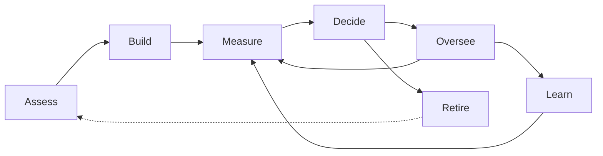

# Earned Autonomy

> **Status:** private working draft. "Earned Autonomy" is a working name. Specification v0.7, public review draft.

**AI agents should earn the right to act on their own the way a new employee does.** Choose the work worth delegating,
measure continuously how far the agent can be trusted on each kind of task, decide what it may do alone from that
measurement, keep watching, keep improving, and know when to stop.

The aim is to **raise the multiple**: the work done per hour of human time, compared with doing it by hand, without
letting more serious mistakes through. Trust can't be shortcut, but it can be made cheaper to earn.

## The problem

Businesses deploying AI agents hit two questions: *which work is worth automating?* and *when can this agent act without
a person checking?* Today both are answered once, on gut feel. Existing frameworks define autonomy levels but don't say
how an agent earns them, and don't publish evidence that their levels work.

## The lifecycle

**Govern** runs through every stage: a named owner, clear roles, versioned rules and a permanent record.

| Stage | In one line |
|---|---|
| **Assess** | Is this task worth automating, and when will it pay back? |
| **Build** | Implement the agent. Outside the standard: any agent can be measured and governed |
| **Measure** | A trust score per task type, updated continuously from evidence |
| **Decide** | Autonomy and oversight follow the measurement: a simple three-level ladder, or a dial |
| **Oversee** | Random hidden spot-checks, alarms, pause, review windows |
| **Learn** | Corrections become rules and tests; every new version is measured again |
| **Retire** | Stop automating work that's rare, critical or no longer pays |

## What's different here

- **Trust per task type, not per agent.** An agent can be trusted with order updates and still supervised on refunds.
- **Measured, not certified.** Trust is a score that keeps updating, not a one-off sign-off.
- **Thresholds backed by evidence.** The rules come from statistics and were tested in pre-registered experiments,
  failures included. A simple version runs on lookup tables.
- **Scoped step-down.** A slip affects that one task type, one level, not the whole agent.
- **Runnable, not just written.** A reference trust engine and a conformance test suite ship with the specification.

## Start here

| You are… | Read |
|---|---|
| A leader deciding whether to adopt it | [PRINCIPLES.md](PRINCIPLES.md): one page |
| New to the idea | [docs/primer.md](docs/primer.md): concepts and why it works |
| Choosing what to automate | [docs/assessment-guide.md](docs/assessment-guide.md): the cost model and verdicts |
| Running agents day to day | [docs/guide.md](docs/guide.md): the practitioner guide, by lifecycle stage |
| Building agents | [docs/implementation-guide.md](docs/implementation-guide.md): building agents that earn trust fast |
| An engineer building the machinery | [spec/README.md](spec/README.md), then [engine/README.md](engine/README.md) and [conformance/](conformance/) |
| Checking the evidence | [research/README.md](research/README.md): every pre-registered experiment and how to verify it |

## Repository map

| Path | What it is | Normative? |
|---|---|---|
| [PRINCIPLES.md](PRINCIPLES.md) | The principles on one page | No |
| [docs/primer.md](docs/primer.md) | Introduction for first-time readers | No |
| [docs/assessment-guide.md](docs/assessment-guide.md) | Assess: choosing what to automate | No |
| [docs/guide.md](docs/guide.md) | Practitioner guide, by lifecycle stage | No |
| [docs/implementation-guide.md](docs/implementation-guide.md) | Build: advice on building agents (outside the standard) | No |
| [docs/launch-checklist.md](docs/launch-checklist.md) | What must happen before this goes public | No |
| [spec/](spec/README.md) | The specification, organised by lifecycle stage | **Yes** |
| [engine/](engine/README.md) | Reference trust engine (Python) | Reference implementation |
| [conformance/](conformance/) | Conformance tests and the [compliance matrix](conformance/compliance-matrix.md) | Tests the specification |
| [research/](research/README.md) | The Trust Gym: pre-registrations, reports, code and data | No (evidence) |
| [CROSSWALKS.md](CROSSWALKS.md) | How this maps to other frameworks and standards (draft) | No |
| [CHANGELOG.md](CHANGELOG.md) · [GOVERNANCE.md](GOVERNANCE.md) · [CONTRIBUTING.md](CONTRIBUTING.md) | Project housekeeping | No |

Only the files under `spec/` are normative. Everything else explains, guides or provides evidence.

---

Maintained by Hivemind Labs. Private until launch; see the [launch checklist](docs/launch-checklist.md).
