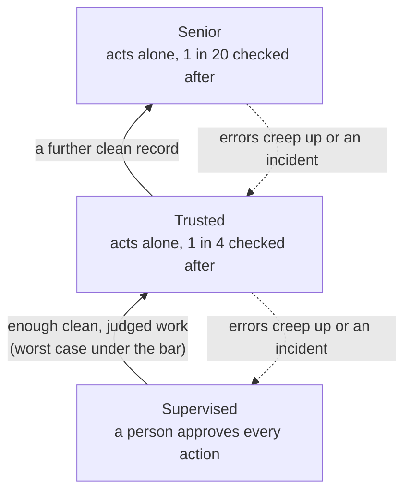

# Earned Autonomy

> **Status:** private working draft. "Earned Autonomy" is a working name. Specification v0.6, public review draft.

**AI agents should earn the right to act on their own the way a new employee does.** They start supervised, learn from
every correction, and are trusted with more as their record proves it, one kind of work at a time, under clear
oversight and governance.

## The problem

Businesses deploying AI agents all hit the same question: *when can this agent act without a person checking?* Today
the answer is a switch someone flips on gut feel. Existing frameworks define autonomy levels but don't say how an agent
earns a promotion, and don't publish evidence that their levels work.

## What's different here

- **Trust per task type, not per agent.** An agent can be trusted with order updates and still supervised on refunds.
- **Thresholds backed by evidence.** Promotion and step-down rules come from statistics and were tested in pre-registered
  experiments, failures included.
- **Step-down is scoped.** A slip drops that one task type one level, not the whole agent back to the start.
- **Runnable, not just written.** A reference trust engine and a conformance test suite ship with the specification.

## The ladder

Each task type climbs on its own record. Work with critical consequences (moving money, deleting records) never
climbs. Checks run on every action at every level.

## Start here

| You are… | Read |
|---|---|
| A leader deciding whether to adopt it | [PRINCIPLES.md](PRINCIPLES.md): one page |
| New to the idea | [docs/primer.md](docs/primer.md): concepts and why it works |
| Running agents day to day | [docs/guide.md](docs/guide.md): the practitioner guide |
| An engineer building it | [spec/README.md](spec/README.md), then [engine/README.md](engine/README.md) and [conformance/](conformance/) |
| Checking the evidence | [research/README.md](research/README.md): every pre-registered experiment and how to verify it |

## Repository map

| Path | What it is | Normative? |
|---|---|---|
| [PRINCIPLES.md](PRINCIPLES.md) | The principles on one page | No |
| [docs/primer.md](docs/primer.md) | Introduction for first-time readers | No |
| [docs/guide.md](docs/guide.md) | Practitioner guide: roles, rituals, getting started | No |
| [docs/launch-checklist.md](docs/launch-checklist.md) | What must happen before this goes public | No |
| [spec/](spec/README.md) | The specification: [levels](spec/levels.md), [requirements](spec/requirements/), [threats](spec/threats.md), [examples](spec/examples.md) | **Yes** |
| [engine/](engine/README.md) | Reference trust engine (Python) | Reference implementation |
| [conformance/](conformance/) | Conformance tests and the [compliance matrix](conformance/compliance-matrix.md) | Tests the specification |
| [research/](research/README.md) | The Trust Gym: pre-registrations, reports, code and data | No (evidence) |
| [CROSSWALKS.md](CROSSWALKS.md) | How this maps to other frameworks and standards (draft) | No |
| [CHANGELOG.md](CHANGELOG.md) · [GOVERNANCE.md](GOVERNANCE.md) · [CONTRIBUTING.md](CONTRIBUTING.md) | Project housekeeping | No |

Only the files under `spec/` are normative. Everything else explains, guides or provides evidence.

---

Maintained by Hivemind Labs. Private until launch; see the [launch checklist](docs/launch-checklist.md).
