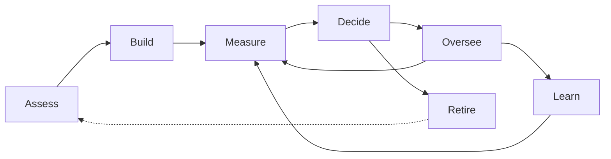

# Earned Autonomy: practitioner guide

*Working name. Version 0.7, October 2026. Hivemind Labs.*

This guide is for the people who run AI agents in a business: team leads, department heads, operations and compliance
staff. It explains how to apply the [principles](../PRINCIPLES.md) day to day, stage by stage. It doesn't depend on any
particular agent platform. Engineers building the machinery should read the [specification](../spec/README.md).

This guide is informative. Where it describes a rule, the binding wording is in the specification, under the same
lifecycle stage. If the two ever disagree, the specification wins.

---

## 1. The idea in one paragraph

An agent earns freedom the way a new employee does. For every kind of task it does, we keep measuring how sure we are
that it's good enough. That measurement decides how much it may do alone and how closely it's watched. Every
correction becomes a lesson, every change to the agent is measured again, and a named person is accountable
throughout. Some work is never handed over, and some isn't worth automating at all.

**The aim is to raise the multiple:** the work done per hour of human time, compared with doing it by hand.

---

## 2. The lifecycle

**Govern** runs through every stage: a named owner, clear roles, versioned rules and a permanent record.

| Stage | Question it answers | Who leads it |
|---|---|---|
| **Assess** | Is this task worth automating, and will it pay back? | AI owner |
| **Build** | How is the agent implemented? (Outside the standard: see the [implementation guide](implementation-guide.md)) | Builder |
| **Measure** | How sure are we, right now, that the agent is good enough at this task? | The system, read by the AI owner |
| **Decide** | Given that, how much may it do alone, and how closely is it watched? | The system by rule; the AI owner for exceptions |
| **Oversee** | Is it still behaving? Can we stop it? | Reviewers, AI owner |
| **Learn** | How does it get better, and is the new version still trustworthy? | Builder, policy owner |
| **Retire** | When should we stop automating this? | AI owner |

---

## 3. Roles

| Role | Who it usually is | Responsible for |
|---|---|---|
| **AI owner** | A team lead or department head | The agents in their area: which task types they do, how much each matters (consequence level), and whether automation continues |
| **Policy owner** | Operations, risk or compliance lead | The rules: error bars, what is never handed over, spot-check rates, review windows |
| **Reviewer** | Staff who know the work | Judging the agent's actions: approve, fix or reject, and say why |
| **Auditor** | Internal audit, or an external assessor | Reading the record. Changing nothing |
| **Builder** | Whoever configures or changes the agent | New versions of the agent. Never approves its own agent's autonomy |

One person can hold several roles, except that **a builder never approves their own agent's autonomy or loosens its
rules.**

---

## 4. Assess

Before building anything, decide which task types are worth automating. The [assessment guide](assessment-guide.md)
gives the full cost model: setup, the reviews needed to earn trust, ongoing review and model cost, against doing the
work by hand. It ends with a verdict for each task type: **automate**, **assisted**, **keep manual** or **not yet**.

The output of Assess is the **task catalogue**: every kind of work the agent will do, each with a description, a few
example requests, the tools it may use and a consequence level.

---

## 5. Build

How the agent is implemented is outside this standard: any agent, on any platform, can be measured and governed by it.
The framework only asks two things of the agent:

- **It declares its tools per task type,** so it is only offered the tools that task needs.
- **It supplies a checks result** for every proposed action, so failed checks can be held.

For practical advice on building agents that earn trust quickly (narrow tools, precise checks, approved playbooks, a
training camp before go-live), see the [implementation guide](implementation-guide.md).

---

## 6. Measure

For every task type, the framework keeps a current **trust measurement**:

| Part | Example |
|---|---|
| **Trust score:** how confident we are that the agent's true serious-mistake rate is under the bar | 97% confident it's under 5% |
| **Estimated mistake rate,** with its plausible range | 1.2%, plausibly 0.3% to 3.9% |
| **Evidence strength** | Equivalent to 140 judged actions |
| **Evidence sources** | Reviews 80 · shadow comparison 50 · past cases 30 |
| **Freshness** | Current version, last evidence 2 days ago |
| **Trend** | Stable, improving or slipping |

Across all its task types, an agent gets a **trust summary**: for example, "trusted for 64% of its work by volume;
supervised on refunds and quotes; one incident in 30 days".

### Where evidence comes from

Evidence is gathered **before** any harm can happen. Pick the mode by what's available for each task type:

| What exists | Evidence mode | Human time |
|---|---|---|
| Staff work leaves a digital trace you can compare against (an email sent, a record changed) | **Shadow comparison:** staff keep doing the work; the agent drafts in parallel and nothing is sent; the system compares the agent's decision and facts with what the person did | None extra |
| Past cases are recorded | **Historical replay:** test the agent on cases people already handled | None |
| Neither | **Supervised review:** a person approves each of the agent's drafts before anything happens | One review per action |

**What never earns trust:** signals that only appear after something has gone out, such as a complaint, a reversal or
"nothing bad happened". By then the harm is done. Those signals are still useful as **alarms** (below), but they can
only lower trust, never raise it.

---

## 7. Decide

The measurement decides how much the agent may do alone for each task type.

### Core: the ladder

| Level | What happens |
|---|---|
| **Supervised** | A person approves every action before it happens. Every new agent and every new task type starts here |
| **Trusted** | Acts on its own; about 1 in 4 actions checked afterwards |
| **Senior** | Acts on its own; about 1 in 20 checked afterwards |

**Promote** one level when the task type has enough judged actions for its consequence level and its mistakes so far,
and at least 30 judged actions have passed since its last change:

| Serious mistakes so far | 0 | 1 | 2 | 3 | 4 | 5 |
|---|--:|--:|--:|--:|--:|--:|
| **C1 Low** (bar 10%) | 35 | 53 | 69 | 84 | 99 | 113 |
| **C2 Moderate** (bar 5%) | 73 | 110 | 142 | 173 | 202 | 230 |
| **C3 High** (bar 2%) | 189 | 280 | 361 | 437 | 510 | 581 |

**Step down** one level when serious mistakes among the last 50 judged actions reach **10 (C1), 6 (C2) or 3 (C3)**, or
on any incident. **Critical (C4) work never acts alone.** The full tables are in
[research/core/core-tables.md](../research/core/core-tables.md). They reproduce the statistical rule exactly, so no
statistics knowledge is needed.

### Advanced: a dial

Instead of three fixed levels, oversight can follow the trust score directly: check more where the measurement is less
certain, less where it's very certain. This is being tested; see [research/README.md](../research/README.md).

### The full menu of decisions

At any measurement, the options are: **give it more autonomy**, **keep it as it is**, **check it more**, **narrow its
scope**, **improve it** (a new version), **pause it**, or **retire it**.

### Consequence levels

The AI owner gives every task type a consequence level. It sets how good the agent must prove to be. It never predicts
how good the agent *is*: in testing, "low-risk" work was often where agents made the most mistakes.

| Level | Typical work | Maximum serious-mistake rate |
|---|---|---|
| **C1 Low** | Internal notes, tagging, answers to common questions; easy to undo | 10% |
| **C2 Moderate** | Customer replies, bookings, record updates | 5% |
| **C3 High** | Commitments, small refunds, access changes | 2% |
| **C4 Critical** | Money, deletions, legal, irreversible | Never acts alone |

**What counts as a serious mistake:** a wrong or unauthorised action, a made-up fact or amount, a promise the policy
doesn't allow, or obeying an instruction hidden in a message. Changes to wording or tone don't count.

---

## 8. Oversee

- **Random, hidden spot-checks.** A share of autonomous actions is reviewed afterwards. The agent never knows which, and
  checks never follow a fixed schedule. In testing, an agent that could predict its reviews looked eighteen times
  better than it really was.
- **Planted test items (canaries).** A few known mistakes are slipped into review queues to check reviewers are still
  catching things. In testing, canaries were what kept a simple setup as safe as the full one.
- **Alarms.** A complaint, a reversal or a "this was wrong" report steps that task type down at once. Alarms can only
  lower trust.
- **Pause.** The AI owner can pause an agent or a single task type in one step.

### When reviewers aren't available

The framework doesn't assume reviewers are watching 24 hours a day.

- **Review windows.** Queues are cleared at set times, for example twice a day.
- **Waiting-time limits per task type,** set by the AI owner: for example, customer replies within 2 hours, supplier
  chasers within a day.
- **Batches close on size or time, whichever comes first:** for example, 20 items or 30 minutes. Urgent task types get
  small, frequent batches.
- **Only pre-reviews cause delay.** Spot-checks happen after the action, so batching them delays nothing. As task types
  earn trust, the delay disappears.
- **Nothing acts because nobody reviewed it.** An unreviewed action waits; it never goes ahead on a timeout.

### Critical work with a deadline

For example, a payment due on a long weekend:

1. **See it coming.** The system knows upcoming deadlines and reviewers' calendars, and flags critical work due inside a
   gap before the gap starts.
2. **Approve in advance, with conditions.** For example, "release this payment on Tuesday if the amount and bank
   details are unchanged". It runs only if every condition still holds.
3. **An on-call approver** named by the AI owner, with one-step approval that shows the full context.
4. **If nobody approves,** the fallback set by the policy owner applies: escalate, tell the affected party about the
   delay, and record the miss.

---

## 9. Learn

- **Always give a reason** when fixing or rejecting. A reason turns a correction into a rule or a test.
- **Every change to the agent is a new version,** including knowledge edits. Its trust is measured again. It keeps its
  standing if it passes at least 80% of its hidden tests; otherwise it loses half its record.
- **Hidden tests stay hidden.** Neither the agent nor whoever improves it may see them.
- **Batch changes into regular releases,** for example weekly, so the agent isn't constantly re-measured.
- **Passing tests never counts as evidence for autonomy.** Tests catch the agent changing; only judged work shows how it
  does on the real job.

---

## 10. Retire

- **Rare task types stay supervised.** A task done twice a month would take years to build a record, but costs only two
  reviews a month to keep checking. That's rarely worth automating.
- **Back after a break.** A task type unused for more than 60 days steps down one level when it returns.
- **Stop when it doesn't pay.** If the assessment says a task type no longer pays back, retire its automation and say
  why in the record.

---

## 11. Govern (throughout)

| Artefact | What it is | Who keeps it |
|---|---|---|
| **Task catalogue** | Every task type, with description, examples, tools and consequence level | AI owner |
| **Policy file** | Error bars, what's never handed over, spot-check rates, review windows, waiting-time limits. Versioned; every change logged | Policy owner |
| **Trust record** | Every action, decision, review, correction and incident, permanently. Labels and references, not customer content | The system; auditors read it |
| **Review queue** | Actions waiting for a person, and sampled actions to check afterwards | Reviewers |
| **Test suites** | Tests built from real corrections. Some are hidden | The system, approved by the policy owner |

### Rituals

| Ritual | Stage | When | Who |
|---|---|---|---|
| **Review queue** | Oversee, Measure | In review windows, daily | Reviewers |
| **Trust review:** measurements, promotions, step-downs, near-misses | Measure, Decide | Weekly | AI owner |
| **Release review:** batch corrections and knowledge edits into one tested release | Learn | Weekly | AI owner, builder |
| **Incident review:** what happened, why it got through, what prevents it again | Oversee, Learn | Within 48 hours | AI owner, policy owner |
| **Agent review:** is the scope right, does it still pay back, should anything retire? | Assess, Retire | Quarterly | AI owner, policy owner |

---

## 12. What to expect

From pre-registered testing on simulated organisations, 6,000 generated tasks done by real AI agents, and a public
benchmark:

| Compared with | What Earned Autonomy does |
|---|---|
| Letting the agent act freely | 83–94% fewer serious mistakes |
| Automatic checks only | 77–91% fewer serious mistakes |
| A person checking everything | About the same safety, with a fifth to a third less review work |

- **Promotions were deserved** 93–100% of the time, and slips were caught within about 14 actions.
- **The multiple** was about 4.4 to 6.3 times over a whole run, and up to about 7.9 times once tasks had earned trust.
- **Trust rules alone don't reach ten times.** Getting further needs cheaper evidence (shadow comparison, replay), faster
  reviews and better agents. See the [implementation guide](implementation-guide.md).

**Not yet proven:** results with real customers and real reviewers (a pilot is the next step), and agents trusting
agents. Every result, with its pre-registration, is in [research/README.md](../research/README.md).

---

## 13. Common questions

**How long until an agent works hands-off?** It depends on the task: about 35 clean judged actions for low-consequence
work, 73 for moderate and 189 for high. Critical work never goes fully hands-off, and checking never drops to zero.

**What about tasks that rarely happen?** They stay supervised, usually for good. See Retire.

**Which tasks are safe to hand over?** You can't tell in advance. In testing, some "simple" tasks were where agents
failed most. The framework finds out per task, from evidence. The assessment guide helps you choose where to start.

**Does the AI model matter?** Yes, and so do its instructions. Changing the model counts as a new version, so trust is
measured again.

**Can automated tests replace spot-checks?** No. Tests catch the agent changing; spot-checks catch the world changing.

**Who's accountable when an autonomous action goes wrong?** The AI owner for that area. The record shows exactly why
the action was allowed: the task type, its measurement, the evidence, the checks and the rules in force.

---

## 14. Glossary

The one glossary for the framework is in [spec/terminology.md](../spec/terminology.md).
