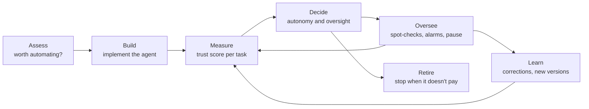

# Primer

*Informative. Start here if you're new to Earned Autonomy.*

## The problem

AI agents now answer customers, process refunds, update records and book appointments. Every business that deploys
one faces two questions:

1. **Which work is worth handing to an agent at all?**
2. **When can the agent do that work without a person checking first?**

Most teams answer both once, by gut feel, for the whole agent: either everything is checked forever, which is safe but
slow, or the agent is switched to "automatic", which is fast but risky. Neither answer changes as the agent gets better
or worse, or as the work changes.

Earned Autonomy answers them the way we answer them for people: **choose the work that's worth delegating, then let
trust be earned from a record of good work, one kind of task at a time, measured continuously, and lost when it
slips.**

## Two sides

| Side | Question | Where |
|---|---|---|
| **Choosing what to automate** | Which task types will pay back the effort, and how fast? | [Assessment guide](assessment-guide.md) |
| **Earning trust** | How far can this agent be trusted on this task right now, and what should happen next? | [Practitioner guide](practitioner-guide.md) and the [specification](../spec/README.md) |

## The lifecycle

**Govern** runs through every stage: a named owner, clear roles, versioned rules and a permanent record nobody can alter.

Build is deliberately outside the standard: any agent, built any way, can be measured and governed. The
[implementation guide](implementation-guide.md) collects advice on building agents that earn trust quickly.

## Core concepts

**Action.** Anything an agent does that changes something: sending a reply, issuing a refund, updating a record,
booking a time. Reading information isn't an action.

**Task type.** A named kind of action, such as `customer_service.refund.issue`. Each task type is an entry in a
**catalogue** with a description, a few example requests, the tools it may use, and a consequence level. Trust is
tracked per task type.

**Consequence level.** How much a mistake on that task type would cost. It sets the bar:

| Level | Typical work | Maximum serious-mistake rate |
|---|---|---|
| Low (C1) | Internal notes, tagging, answers to common questions | 10% |
| Moderate (C2) | Customer replies, bookings, record updates | 5% |
| High (C3) | Commitments, small refunds, access changes | 2% |
| Critical (C4) | Money, deletions, legal or irreversible actions | Never acts alone |

**Trust score.** For each task type: how confident we are that the agent's true serious-mistake rate is under the bar.
For example, "97% confident the agent's error rate on invoice queries is under 5%". It updates continuously, behind a
profile showing the estimated rate, the evidence and its sources, freshness and trend.

**Autonomy setting.** What the measurement allows. In the simple version (Core), three levels:

- **Supervised:** a person approves every action before it happens. Everything starts here.
- **Trusted:** the agent acts alone; about one in four actions is checked afterwards.
- **Senior:** the agent acts alone; about one in twenty actions is checked afterwards.

**AI owner.** The business person accountable for the agents in an area, usually a team lead or department head.

**The multiple.** Work done per hour of human time, compared with doing it by hand. Raising it, without letting more
serious mistakes through, is the point of the whole framework.

## Why worst-case evidence?

If an agent handles five refunds correctly, its error rate so far is zero, but five is too few to know anything: it
could really be getting one in three wrong and have been lucky. So the framework doesn't ask "what's the error rate?".
It asks: **"what's the highest error rate that could still plausibly explain what we've seen?"**

That worst case shrinks as clean work builds up. A useful rule of thumb: with no mistakes, the worst case is roughly
**4 ÷ the number of judged actions**. To be confident the error rate is under 5%, an agent needs about **73 clean
judged actions**. One mistake along the way raises that to about 110.

- **Give more autonomy when even the worst case looks good.**
- **Take it back when even the best case looks bad.** For example, six serious mistakes in the last fifty judged
  actions.

So trust is slow to gain and quick to lose, and checking never stops. Teams that don't want the statistics can use
lookup tables that give the same answers.

## Where evidence comes from

Only from judged work, gathered before anything can go wrong: a person's review, a **shadow comparison** with what staff
actually did, or **past cases**. Complaints and reversals only appear after the harm is done, so they act as alarms that
lower trust, never as evidence that raises it.

## What the evidence shows

Pre-registered experiments on simulated organisations, 6,000 generated tasks done by real AI agents, and a public
customer-service benchmark found:

- **83–94% fewer serious mistakes** than letting an agent act freely;
- **93–100% of promotions were deserved**, and slips were caught within about **14 actions**;
- **every autonomous action could be explained**;
- **the multiple** was about 4.4 to 6.3 times. Trust rules alone don't reach ten times; better agents and cheaper
  evidence are the next levers.

Some recommendations failed their tests and were dropped; the reports say which. All of this is synthetic so far. A
real-world pilot is the next step. Details: [research/README.md](../research/README.md).

## Where to go next

- Choosing what to automate: [the assessment guide](assessment-guide.md)
- Running agents day to day: [the practitioner guide](practitioner-guide.md)
- Building agents that earn trust fast: [the implementation guide](implementation-guide.md)
- Building the machinery: [the specification](../spec/README.md) and the [reference engine](../engine/README.md)
