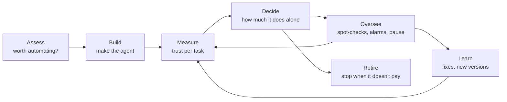

# Primer

The core ideas of Earned Autonomy in about ten minutes. For why it matters, start with the [README](../README.md).

## The lifecycle

**Govern** runs through every stage: a named owner, clear roles, versioned rules and a permanent record.

Build is outside the standard: any agent, built any way, can be measured and governed.

## Core ideas

**Action.** Anything an agent does that changes something: sending a reply, issuing a refund, updating a record.
Reading information isn't an action.

**Task type.** A named kind of action, such as "issue a refund". Each one sits in a **task catalogue** with a
description, a few example requests, the tools it may use and a consequence level. Trust is tracked per task type.

**Consequence level.** How much a mistake would cost. It sets how good the agent must prove to be:

| Level | Typical work | Highest acceptable serious-mistake rate |
|---|---|---|
| **C1 Low** | Internal notes, tagging, common questions | 10% |
| **C2 Moderate** | Customer replies, bookings, record updates | 5% |
| **C3 High** | Commitments, small refunds, access changes | 2% |
| **C4 Critical** | Whatever your organisation decides must never be handed over | Never acts alone |

The level sets the bar; it doesn't predict how good the agent is. In testing, "simple" work was often where agents made
the most mistakes.

**Serious mistake.** A wrong or unauthorised action, a made-up fact or amount, a promise the policy doesn't allow, or
obeying an instruction hidden in a message. Wording and tone changes don't count.

**Trust score.** For each task type: how confident we are that the agent's real serious-mistake rate is under the bar.
For example, "97% confident it's under 5% on invoice queries". It updates with every judged action.

**Autonomy setting.** What the trust score allows. The simple version has three levels:

- **Supervised:** a person approves every action first. Everything starts here.
- **Trusted:** the agent acts alone; about 1 in 4 actions is checked afterwards.
- **Senior:** the agent acts alone; about 1 in 20 is checked afterwards.

**AI owner.** The business person accountable for the agents in an area, usually a team lead.

**The multiple.** Work done per hour of people's time, compared with doing it by hand. Raising it without letting more
mistakes through is the point.

## Why judge on the worst case?

Five correct refunds prove little: the agent could really be getting one in three wrong and have been lucky. So the
question isn't "what's the error rate?" but **"what's the highest error rate that could still explain what we've
seen?"**

That worst case shrinks as clean work builds up. Rule of thumb: with no mistakes, it's about **4 ÷ the number of judged
actions**. To be confident an agent is under 5%, it needs about **73 clean judged actions**. One mistake raises that to
about 110.

- **Give more freedom when even the worst case looks good.**
- **Take it back when even the best case looks bad.**

So trust is slow to gain, quick to lose, and checking never stops. No statistics needed: lookup tables give the same
answers.

## Where evidence comes from

Only from work judged before anything can go wrong: a person's review, a comparison with what staff actually did, or
past cases. Complaints arrive after the harm is done, so they lower trust but never raise it.

## Does it work?

Pre-registered experiments on simulated organisations, 6,000 tasks done by real AI agents, and a public benchmark:

- **83–94% fewer serious mistakes** than letting an agent act freely, and 77–91% fewer than automatic checks alone.
- **About the same safety as checking everything,** with a fifth to a third less review work.
- **93–100% of promotions were deserved,** and slips were caught within about 14 actions.
- **The multiple was about 4.4 to 6.3 times.** Trust rules alone don't reach ten times; better agents and cheaper
  evidence are the next levers.

Some recommendations failed and were dropped. All evidence so far is simulated; a real-world pilot is next. Details:
[research](../research/README.md).

## Where to go next

- Choosing what to automate: [assessment guide](assessment-guide.md)
- Running agents day to day: [practitioner guide](practitioner-guide.md)
- Building agents that earn trust fast: [implementation guide](implementation-guide.md)
- Building the machinery: [specification](../spec/README.md) and [reference engine](../engine/README.md)
